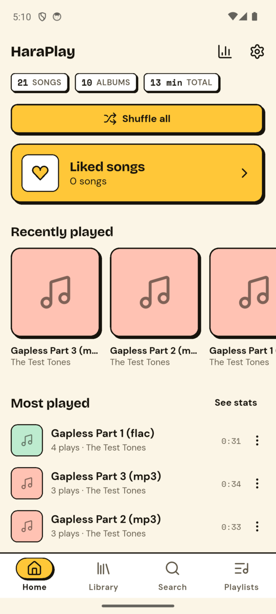
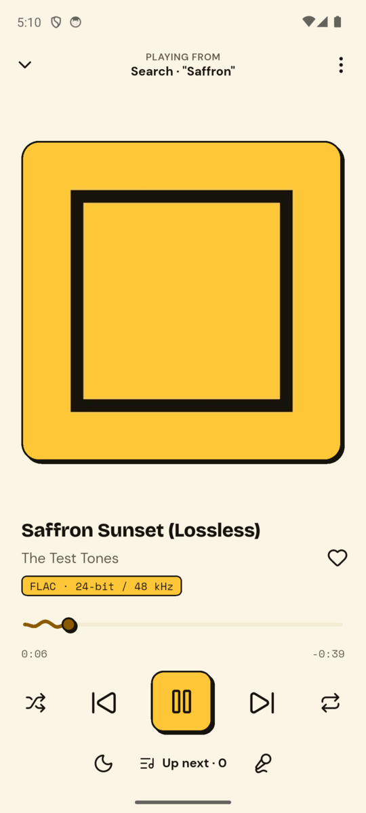
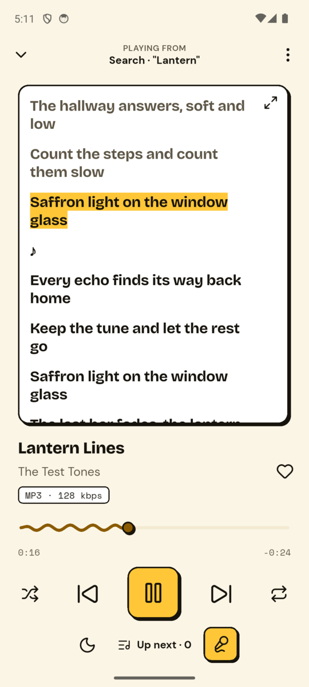
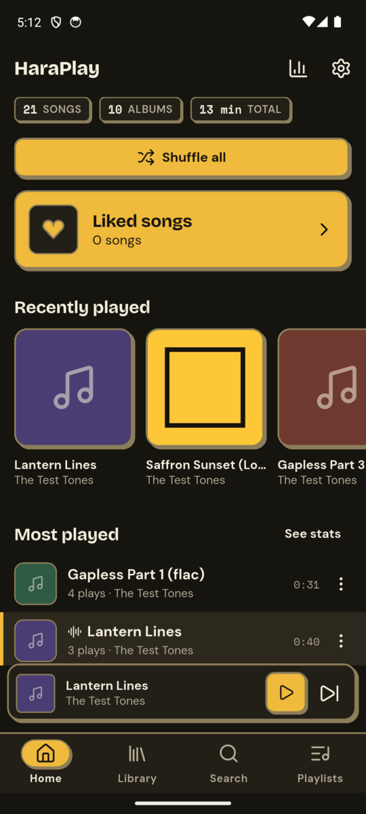
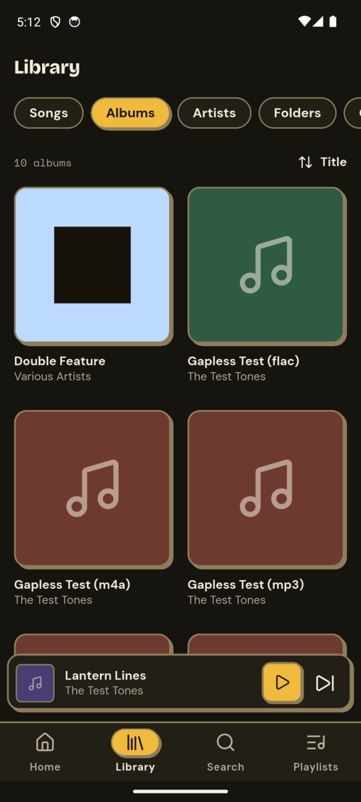
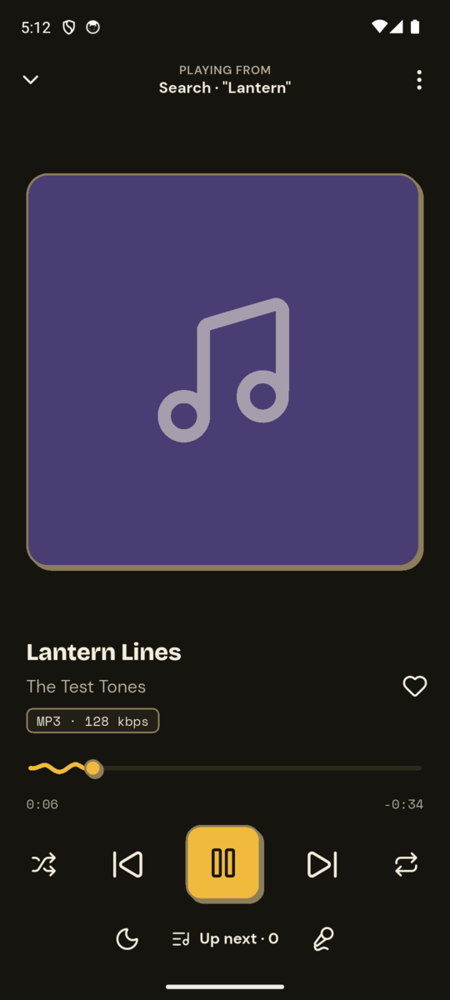
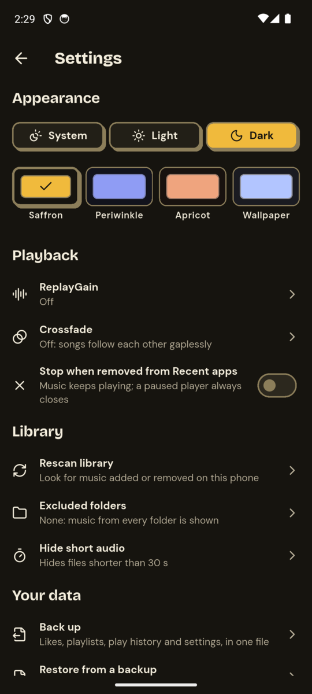

# HaraPlay

**An offline music player for Android.** HaraPlay plays the music files
already on your phone. No streaming, no account, no ads, no tracking, and
no internet permission at all: nothing leaves your device.

Built with Flutter, with a bold neo-brutalist look (thick outlines, hard
shadows, a saffron accent) in light and dark.

> **Status:** early release (0.1.2). Found a bug or missing something? Please
> open an [issue](https://github.com/MapIHS/HaraPlay/issues).

<p>
  
  
  
</p>
<p>
  
  
  
  
</p>

## Features

**Library**
- Reads your music through Android's MediaStore: songs, albums, artists,
  folders and genres, each with its own sort options.
- Search across titles, artists and albums.
- Home with recently played, most played and recently added.
- Listening stats with charts.
- Fixes up messy tags: reads files' own tags where MediaStore's are missing
  or garbled, and guesses artist and title from file names.
- Hide short audio (ringtones, voice notes), exclude folders, and rescan
  automatically when files change.

**Playback**
- Gapless playback, shuffle and repeat, a reorderable queue.
- Notification and lock-screen controls with a ✕ to close; pauses when
  headphones are unplugged. Optionally stops when swiped away from Recent
  apps.
- Optional crossfade (2–12 s); tracks of the same album played in order stay
  gapless.
- Sleep timer with a gentle fade-out, playback speed (0.5–2×, pitch kept).
- ReplayGain (track or album).
- Swipe the artwork to change songs, double-tap its sides to skip 10 s.

**Your music, your way**
- Likes and playlists; import and export playlists as `.m3u`.
- Lyrics: synced `.lrc` files next to the song, or lyrics embedded in the
  file, with the current line highlighted.
- Audio details: format, bit depth and sample rate (e.g. "FLAC · 24-bit /
  96 kHz"), bitrate.
- Light, dark or system theme; Saffron, Periwinkle and Apricot palettes, or
  your wallpaper's colours on Android 12+.
- "Open with" for audio files from other apps.
- Back up likes, playlists, play history and settings to a file, and restore
  it on a new install or another phone. Restoring adds to what's there and
  never replaces anything.

## Install

1. Download `HaraPlay-<version>.apk` from the
   [latest release](https://github.com/MapIHS/HaraPlay/releases/latest).
   Optionally check it against the `.sha256` file next to it.
2. Open the APK on your phone and allow installing from that source when
   Android asks.
3. Open HaraPlay and allow access to your music.

**Requires Android 7.0 (API 24) or newer.** Updates from the Releases page
install over the previous version and keep your data.

## Permissions

These are all the permissions in the release app (its merged manifest).
There is **no `INTERNET` permission**: HaraPlay can't connect to anything.

| Permission | Why |
|---|---|
| `READ_MEDIA_AUDIO` (Android 13+) | Read your music files. |
| `READ_EXTERNAL_STORAGE` (Android 12 and older only) | The same, on older Android versions. |
| `POST_NOTIFICATIONS` (Android 13+) | Show the playback notification with its controls. |
| `FOREGROUND_SERVICE`, `FOREGROUND_SERVICE_MEDIA_PLAYBACK` | Keep playing when the app is in the background or the screen is off. |
| `WAKE_LOCK` | Keep the processor awake while music plays with the screen off. |
| `ACCESS_NETWORK_STATE` | Added by ExoPlayer (Android's media player library). It only lets the app check whether a network connection exists; it gives **no internet access**, and HaraPlay never uses it, since `INTERNET` is absent. |
| `com.mmi.haraplay.DYNAMIC_RECEIVER_NOT_EXPORTED_PERMISSION` | Added by AndroidX. A private, signature-level permission that keeps the app's own internal broadcasts from reaching other apps; it grants nothing. |

## Known limitations

- Gapless playback of **AAC / M4A** albums has a tiny 5–11 ms dip at each
  track change (the encoder's padding, handled inside ExoPlayer). FLAC and
  MP3 albums are fully gapless.
- The **equalizer** and loudness boost are temporarily disabled: on some
  devices they caused sudden volume bursts. Settings saved by 0.1.0 or in
  a backup are kept and will apply again once it's back.
- "Crossfade when skipping" starts about 0.2–0.3 s after the tap.
- **Lyrics** are read from a `.lrc` file next to the song (same name) or
  from lyrics embedded in the file; there is no lyrics folder setting, and
  synced lyrics embedded as ID3 SYLT frames aren't supported.
- **Wallpaper colours** need Android 12 or newer.
- While paused, the notification stays on the lock screen for 2 minutes
  and can be swiped away after that (or closed any time with its ✕); after
  10 minutes paused it closes by itself. The queue and position are kept
  and resume from the app.
- Android only.

## Build from source

Requirements: Flutter 3.47+ (Dart 3.13+), the Android SDK and JDK 17.

```bash
flutter pub get
flutter analyze
flutter test
flutter run                    # debug build on a connected device
```

The two build types are separate Android apps, so they can be installed
side by side, each with its own data:

| | Release | Debug |
|---|---|---|
| Application ID | `com.mmi.haraplay` | `com.mmi.haraplay.debug` |
| Name / icon | HaraPlay | HaraPlay Dev (dark icon with a DEV badge) |
| Build | `flutter build apk --release` | `flutter build apk --debug` |

### Signing a release build

Release builds are signed with the key described in
`android/key.properties`, which is not part of this repository:

```properties
storeFile=/absolute/path/to/your-release.jks
storePassword=…
keyAlias=…
keyPassword=…
```

Create your own keystore (for example with `keytool -genkeypair -v
-keystore your-release.jks -keyalg RSA -keysize 2048 -validity 10000
-alias haraplay`) and keep it and `key.properties` out of version control
(both are in `.gitignore`). Without `key.properties` the release APK is
built unsigned and won't install. An APK signed with your own key can't
update the official release app (or the other way round); Android requires
uninstalling the other one first.

### Code generation and tools

- The drift database code (`*.g.dart`) is generated and committed. After
  changing a table or DAO, run `dart run build_runner build`.
- `dart run tool/gen_icons.dart` regenerates `HaraIcons` from
  `tool/icons.txt` (Lucide icon names).
- `tool/make_launcher_icons.sh` (and `… dev` for HaraPlay Dev) renders the
  launcher icons from `tool/icon/` (needs ImageMagick with librsvg).
- `tool/make_test_audio.sh` and the other `tool/make_*_audio.sh` scripts
  generate test tones (needs ffmpeg) for gapless, ReplayGain, lyrics,
  cover art and large-library checks on an emulator.
- Startup timing: `HARAPLAY_DEV_RELEASE=true flutter build apk --release
  --dart-define=HARAPLAY_STARTUP_TRACE=true` builds a release-mode
  HaraPlay Dev (debug key, installs next to the release app) that logs
  each startup step to logcat ("HaraPlay startup:").
  `--dart-define=HARAPLAY_ARTWORK_TRACE=true` logs where each cover comes
  from ("HaraPlay artwork:").

## Clean-room note

HaraPlay was written from scratch. Two existing open-source players,
[nuclear](https://github.com/nukeop/nuclear) and
[omniplay](https://github.com/mininxd/omniplay), were studied only as
visual and behavioural references. No code, assets or text from either
project were copied or translated into HaraPlay. The app icon and all
artwork are original.

## License

HaraPlay is released under the [MIT License](LICENSE)
(© 2026 The HaraPlay Authors). The bundled fonts (SIL Open Font License
1.1), the Lucide icon font (ISC) and the libraries built into the app are
listed in [`THIRD_PARTY_NOTICES.md`](THIRD_PARTY_NOTICES.md).
